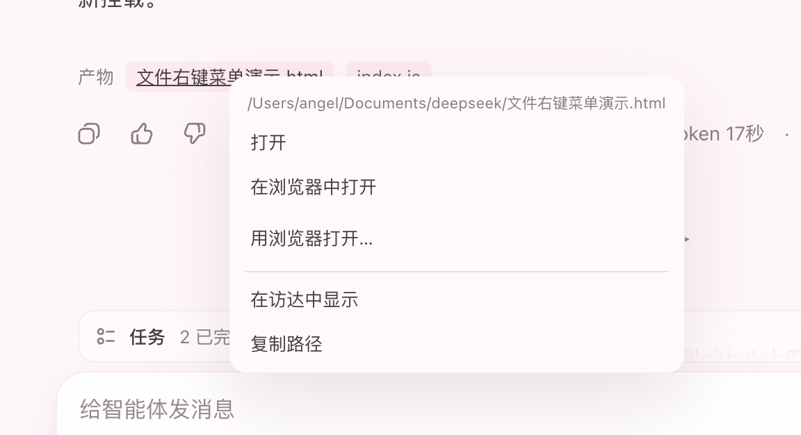
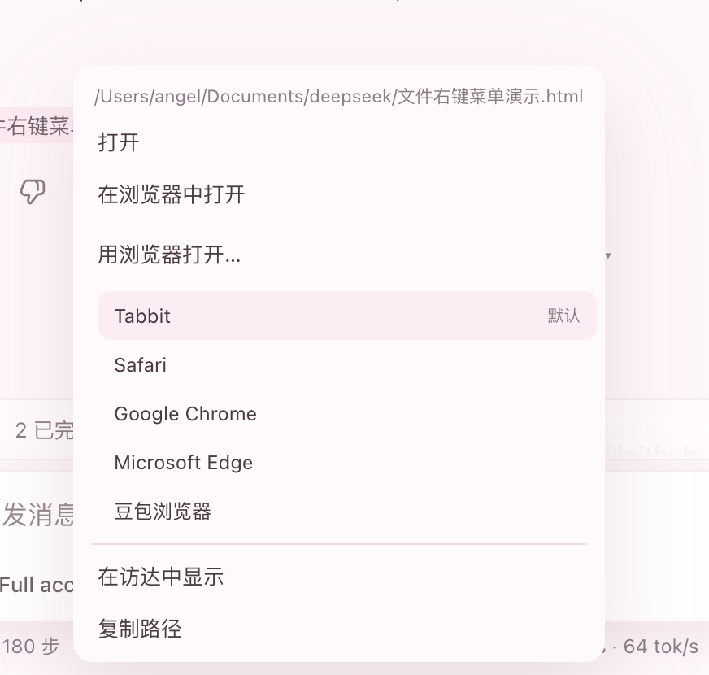

# dsh-plugin-filectx

[中文](README.md) | English

**A right-click context menu for files produced in DeepSeek Harness chats** — like Codex: right-click a file the agent created or modified, then open it, open it in a browser, pick a specific browser, reveal it in Finder, or copy its path.

<p align="center">
  
</p>

## Menu items

| Item | Behavior |
| --- | --- |
| **打开 / Open** | Open with the default application |
| **在浏览器中打开 / Open in Browser** | Force the **default browser** (reads the LaunchServices https handler — the same source DSH's native opener uses) |
| **用浏览器打开… / Open With Browser… ▸** | Lists installed browsers (default marked), `open -a` with the chosen app |
| **在访达中显示 / Reveal in Finder** | `open -R` — locate and select in Finder |
| **复制路径 / Copy Path** | Full absolute path to the clipboard (`pbcopy`, with a UTF-8 locale fix for non-ASCII paths) |

<p align="center">
  
</p>

## Where right-click works

1. **The “产物 / Produced” row** — files actually mutated in a turn, listed at the end of the reply:

   <p></p>

2. **Inline file mentions** — paths the model writes as inline code in its closing prose render as clickable references; right-click works there too.

Tool-card collapsed rows (write/edit lines) are out of scope: their visible text is an abbreviated relative path and the DOM carries no full path.

## Install

```bash
git clone https://github.com/Angel2518975237/dsh-plugin-filectx.git
cd dsh-plugin-filectx
./install.sh          # copies the package into ~/node_modules/
./add-to-preset.sh standard   # copies the `standard` preset and appends the row
```

Then start a session on the new preset (**标准模式·文件右键**) and refresh the page once if it was already open.

## How it works

A dual-face Cordis package, structurally identical to DSH's shipped web UI plugins:

- `lib/index.js` — Node half: registers `/filectx-api` on the host webServer (refcounted across sessions), forwards actions to the `subprocess` service with **literal argv arrays — never shell-interpreted**, plus path validation (absolute paths only).
- `lib/client.js` — web half: loads through the product's official `dsh.client` module system, registers the menu in the `shell.overlay` slot, recognizes file chips by the stable `title`-carries-full-path DOM contract, and calls the API over same-origin `fetch`.

## Limitations

- The row is mounted per-session via an agent preset; after a DSH restart, open a session on a preset that carries the row (refresh the page once).
- Full functionality on macOS; Linux degrades to xdg-open / xclip / xsel; Windows unsupported.
- Older turns may need "加载更早 / Load older" clicked before their Produced rows render (the chat view pages events).

## License

[MIT](LICENSE)
