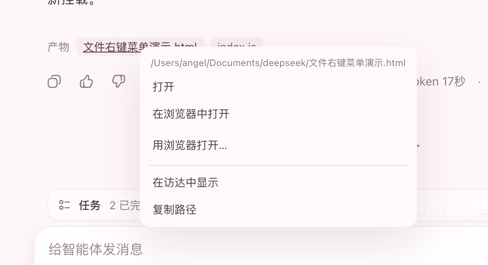
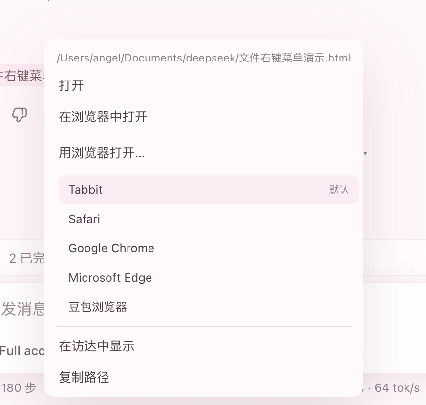

# dsh-plugin-filectx

[English](README.en.md) | 中文

**为 DeepSeek Harness 的聊天文件加上右键菜单** —— 像 Codex 一样，对会话里产生的文件点击右键，即可打开、用浏览器打开、选择浏览器、在访达中定位、复制路径。

<p align="center">
  
</p>

<p align="center">
  <em>对「产物」行的文件 chip 点击右键</em>
</p>

## 菜单项

| 菜单项 | 行为 |
| --- | --- |
| **打开** | 系统默认应用打开 |
| **在浏览器中打开** | 用你的**默认浏览器**打开（读取 macOS LaunchServices 的 https 处理器，与 DSH 原生打开行为一致） |
| **用浏览器打开… ▸** | 展开本机已安装浏览器列表（自动标注“默认”），`open -a` 指定浏览器打开 |
| **在访达中显示** | Finder 定位并选中该文件（`open -R`） |
| **复制路径** | 完整绝对路径进剪贴板（`pbcopy`，已处理 UTF-8 中文路径的 locale 问题） |

<p align="center">
  
</p>

<p align="center">
  <em>浏览器子菜单自动检测本机已安装的浏览器，并标注系统默认</em>
</p>

## 右键生效位置

菜单识别两类文件元素（都是产品自带的“文件”表面，`title` 属性携带完整路径这一稳定 DOM 契约）：

1. **「产物」行的文件 chips** —— 每轮回复末尾，模型实际创建/修改过的文件会列出：

   <p>
     
   </p>

2. **正文中的文件引用** —— 模型在回复里用行内代码写出的文件名（如 `` `报告.html` ``）会渲染为可点击引用，右键同样有效。

> 工具卡片折叠行（如 write/edit 行）不在右键范围内：其显示文本是相对路径缩写，DOM 不携带完整路径。

## 安装

### 前置要求

- macOS（访达定位、`open -R`、`pbcopy` 均为 darwin 路径；Linux 下自动退化为 xdg-open / xclip / xsel）
- [DeepSeek Harness](https://github.com/deepseek-ai/deepseek-harness) ≥ 0.1.1

### 三步安装

```bash
git clone https://github.com/Angel2518975237/dsh-plugin-filectx.git
cd dsh-plugin-filectx
./install.sh
```

`install.sh` 会：

1. 把插件包复制到 `~/node_modules/dsh-plugin-filectx/`（DSH 的宿主加载器与 web 客户端模块扫描都能从这里解析，已实测验证）
2. 给出把插件行加入 agent preset 的指引（也可直接运行 `./add-to-preset.sh standard` 自动完成）

### 为什么是 agent preset 行？

DSH 的能力组合是 Cordis：**每个会话挂载一个 agent preset**，preset 里的插件行在该会话中生效。本插件不发布任何服务（只消费宿主的 `subprocess` / `webServer`），所以一行即可、无需 realm：

```yaml
# agent.cordis.yml 追加
- id: file-context-menu
  name: 'dsh-plugin-filectx'
```

启动会话时选择包含这一行的 preset（如 `add-to-preset.sh standard` 生成的 **标准模式·文件右键**），菜单即在该会话中可用；**如果页面是打开状态，刷新一次** 让浏览器加载菜单模块（web 客户端模块在页面加载时进入 boot graph）。

## 工作原理

双面（dual-face）插件包，与 DSH 官方 web UI 插件同构：

```
package.json        # dsh.client 声明 + exports["./client"]
lib/index.js        # 宿主半（Node）
lib/client.js       # 浏览器半（ModuleLoader bundle）
```

- **宿主半**在 webServer 上注册 `/filectx-api`（按会话引用计数，多会话共享一份注册），把 `/open` `/open-browser` `/open-with` `/reveal` `/copy` `/browsers` 转发到 `subprocess` 服务 —— **全部以 argv 数组执行，绝不经过 shell**，并校验路径（必须绝对路径、无 NUL、限长）。
- **浏览器半**通过产品正式的 `dsh.client` 模块系统加载（`require('react')` 来自平台 seed 表），在 `shell.overlay` 槽位注册菜单 UI，用捕获阶段 `contextmenu` 监听识别文件元素，操作走同源 `fetch` 调用 `/filectx-api`。
- **默认浏览器检测**与产品自带的 `native-path-opener` 同源：`defaults read com.apple.LaunchServices/com.apple.launchservices.secure` 解析 https 处理器 bundle id。
- 菜单样式完全复用产品菜单 token（`--dsw-specific-menu` / `--dsw-shadow-lv3`），界面语言跟随 DSH（中/英词典已注册到 `locale` 服务）。

## 已知边界

- **进程生命周期**：插件行随会话挂载 preset 而生效。DSH 进程重启后，在含该行的 preset 上开一个会话即可（页面刷新一次）。
- macOS 全功能；Linux 下“选择浏览器/访达”退化为 xdg-open 打开所在目录，复制走 xclip/xsel。Windows 未适配。
- 旧版会话里较早回合的「产物」行若未显示，点击会话顶部的“加载更早”加载全部事件后即可出现（DSH 会话视图按事件窗口分页渲染）。

## 卸载

```bash
./uninstall.sh          # 移除 ~/node_modules/dsh-plugin-filectx
```

再从 preset 的 `agent.cordis.yml` 删除 `file-context-menu` 区块（或整个删除该 preset 目录）。

## 许可

[MIT](LICENSE)
